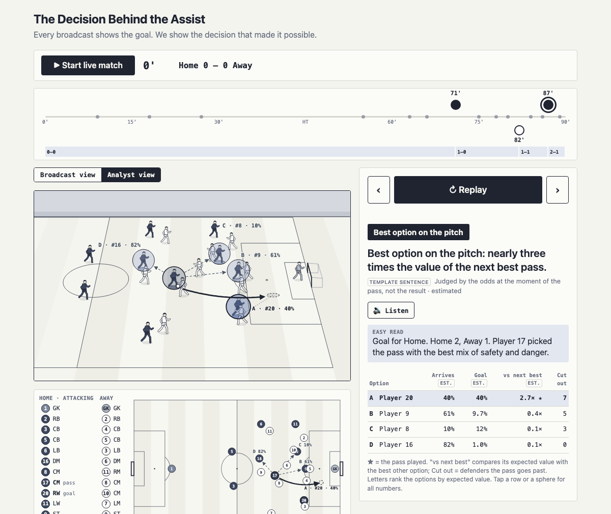

# The Decision Behind the Assist

> Every broadcast shows the goal. We show the decision that made it possible.

A prototype for **Inside the Game: Developer Hackathon (Microsoft × Premier League)**.



## What it does

When a goal goes in, the app replays the killer pass behind it, freezes all 22 players at the moment of the pass,
scores every option the passer had, and tells fans in one plain sentence why this pass was the smart choice.
A live mode runs a whole (synthetic) match in under two minutes, Home 2–1 Away: a 71st-minute opener, an 82nd-minute headed
equaliser and an 87th-minute winner. The quiet first hour flies by, the tense last 25 minutes slow down, and at each goal the insight pops up on its own.
A match timeline (Home goals above the line, Away below) follows the clock and only reveals a goal once the match reaches it. Click any goal, or use ‹ ›, to jump to it.
Each option on the pitch, the map and the table carries a letter (A, B, C…) ranked by expected value. Click a table row to see that option's numbers on the pitch.
For accessibility there is an **Easy read** (two short plain sentences, no percentages) and a **Listen** button that reads the verdict aloud with the browser's built-in speech.

## The problem it solves

Broadcasts show *what* happened: the finish, from three angles. The decision that made it possible, picking one pass
out of ten options in a split second, is invisible. This puts that decision on screen during the celebration and
replay, in percentages anyone can read, always in a positive tone.

## Microsoft / Azure tech

- **Planned, not yet connected:** Azure OpenAI writes the one-sentence verdict from the computed numbers only.
  The page is already structured for it. `buildVerdictPayload()` in `src/scoring.js` builds the exact JSON body for a
  `POST /api/verdict`, and the panel shows a source tag. Today every sentence comes from the built-in template and is labelled **"Template sentence"**.
- **Planned:** Azure Static Web Apps hosts the page, with a managed Azure Functions API for `/api/verdict`.
  The key stays server-side, and the reply falls back to the template on error or timeout.

## Run it locally

Needs Node 18+.

```
npm install
npm run dev         # open the printed URL; press "Start live match"
npm run scores      # every option's numbers + verdict per goal, plus physical checks; exits non-zero on failure
npm run calibrate   # the goal-chance model against reference shots
npm run build       # static build in dist/ (serve it over HTTP; module scripts don't load from file://)
```

Live URL: not deployed yet.

## How the scoring works

At the frozen pass every teammate is an option. Each one gets four numbers:

| Number | Meaning | How |
|---|---|---|
| Chance it arrives (**estimated**) | Will the pass reach them? | 0.98 − 0.012 × distance − 0.25 per defender in the lane − 0.15 if a defender is within 3 units of the receiver, clamped 5–98%. Crosses and lofted balls ignore lane defenders but pay −0.10, since a ball in the air is harder to deliver and control. |
| Chance of a goal (**estimated**) | If it arrives, how dangerous is it? | A logistic on distance and angle to goal, adjusted for outfield defenders between the receiver and the posts. Each one is a partial blocker: full weight inside that triangle, fading to nothing 1.5 units outside it. With no blockers it is × 1.6 (only the keeper to beat), and × 0.8 per full blocker, changing smoothly in between. Clamped 1–70%. |
| Expected value (**estimated**) | Risk and reward together | arrives × goal |
| Defenders cut out (a count) | Opponents the pass goes past | Outfield opponents between the passer and the target and within 12 units of the pass, counted from positions |

**Where each option is scored.** Usually at the teammate's position at the moment of the pass. For a ball into space, the pass played
is scored where it was received, and every other teammate where their own run takes them by the time a ball of the same pace
would arrive. So the pass played gets no head start over the alternatives.

**Verdict, decided by the numbers in this order (ties go to the pass played):**
1. **Best option on the pitch**: the played pass had the highest expected value.
2. **The brave pass**: otherwise, it had the highest chance of a goal.
3. **Line-breaker**: otherwise, it cut out the most defenders.
4. **Perfect timing**: otherwise.

The demo's three goals land on three different verdicts purely from player positions: the opener is a line-breaker,
the equaliser is a brave pass and the winner is the best option on the pitch.
The decision is judged by the odds at the moment of the pass, never by the result. Every number on screen is computed live in the browser.

## Data

- **The app runs on synthetic match data only:** generic players ("Player 8", "Defender 4"), neutral colours, no real names, clubs or logos.
- The goal-chance model's coefficients were hand-tuned against eight reference open-play shots from
  **[StatsBomb Open Data](https://github.com/statsbomb/open-data)** (credit: StatsBomb, used under their terms).
  Those reference numbers live only in the dev script `scripts/calibrate.js`. Nothing from real data is shown in the app.
- All graphics (pitch, player figures, rings) are original SVG drawn for this project.

## Layout

```
index.html          SVG shell: marker defs, player pose symbols, layers; live bar, view toggle, panel
src/scoring.js      pure scoring + verdict payload/template (no DOM; can move to a backend)
src/motion.js       pure motion model shared by the animation and the checks
src/live.js         live match clock + event ticker (no DOM); main.js draws the timeline from it
src/data.js         the three synthetic goal moments (team, minute, 22 positions, motion) and the match events
src/main.js         rendering: perspective pitch, node map, animation timeline, panel
scripts/            scores.js (checks), calibrate.js (model vs reference shots)
```
